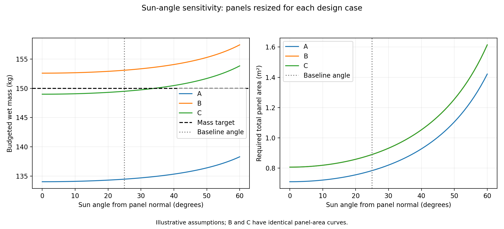

# Earth observation satellite payload trade study

Can a 550 km Earth observation satellite carry a 140 W camera and stay within a 150 kg wet-mass limit? At the nominal 25° solar incidence angle, a 35 kg camera takes the spacecraft 3.10 kg over budget. Reducing camera mass to 32 kg brings it within budget, with 0.50 kg to spare.

## Payload comparison

| Camera option | Camera mass | Power while on | Required solar array area | Spacecraft wet mass | Margin to 150 kg |
|---|---:|---:|---:|---:|---:|
| A · Baseline | 20 kg | 80 W | 0.784 m² | 134.46 kg | +15.54 kg |
| B · Higher demand | 35 kg | 140 W | 0.890 m² | 153.10 kg | −3.10 kg |
| C · Reduced mass | 32 kg | 140 W | 0.890 m² | 149.50 kg | +0.50 kg |

B and C draw the same power, so they require the same array and battery. The 3 kg camera reduction saves 3.60 kg at spacecraft level once the 20% dry-mass contingency is applied. The limiting camera mass at 140 W is 32.42 kg under these assumptions.

## What changes the decision?

The Python model sizes the battery for eclipse and the array for sunlight operation and battery recharge. It uses a 60.04-minute sunlit phase and a 35.61-minute eclipse, a 20% power contingency, and 8 kg of propellant. Camera power is the demand during imaging. Imaging occupies 20% of each orbit and takes place in sunlight.

At 45° incidence, option C needs 1.141 m² of panels and reaches 151.00 kg. Each point in the sweep represents a design sized for that angle. A fixed spacecraft does not gain mass as it rotates. Option A retains 11.72 kg of margin even at 60°. Camera imaging performance and packaging feasibility would need separate assessment before selecting hardware.



## Model and visualisation

The COMET product tree organises eight subsystems beneath the spacecraft. The Camera Payload element has option-dependent mass and operating power, published for all three cases. The same inputs are specified in Python. Unity reads the Python JSON output to display each configuration and scale the two solar wings.

[COMET publication and payload values](figures/comet-publication.png) · [Unity explorer showing option C](figures/unity-view.png) · [Configuration results (CSV)](outputs/configuration_comparison.csv)

## Reproduce the figures

From this folder on Windows, run the following commands with Python 3 installed. The sizing calculation uses the standard library. Matplotlib generates the figures. Close each plot window to return to the terminal.

```powershell
py satellite_design.py
py -m pip install matplotlib
py plot_results.py
py sensitivity_analysis.py
```

The scripts write their results to `outputs/`. The sizing script checks energy balance, average load and the limiting payload mass. The sensitivity script sweeps 0–60° in 1° steps.

The Unity folder contains the C# controller used with the desktop scene. In the existing Unity project, the controller reads `Assets/StreamingAssets/satellite_design_results.json`. The scene and standalone player are separate local project files.
